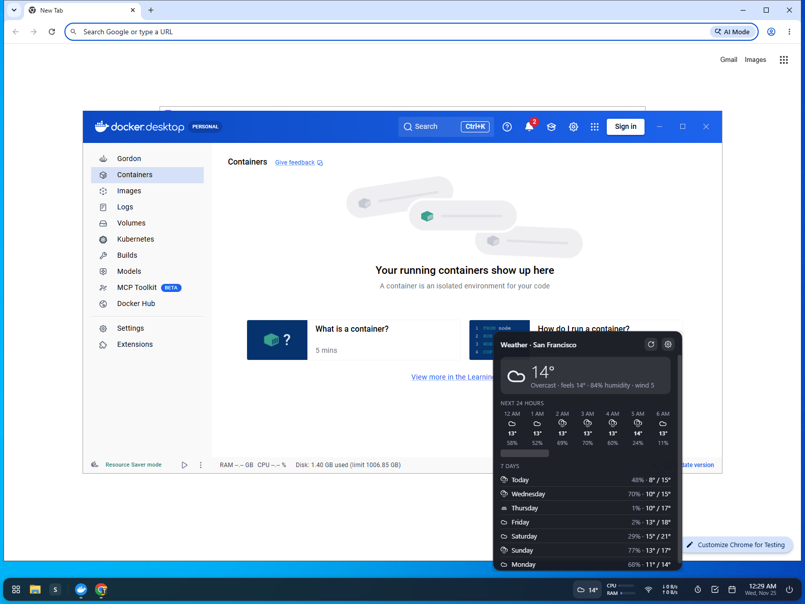

# OpenBar

A free, open-source smart dock and taskbar replacement for Windows 10/11, with live widgets. Inspired by [Lumabar](https://lumabar.xyz), and MIT licensed.



## Download

Get the latest build from the [Releases](https://github.com/jokedud/openbar/releases) page or the artifacts of the latest [build workflow](https://github.com/jokedud/openbar/actions/workflows/build.yml) run:

- `OpenBar-x.y.z-portable-x64.exe`: run it directly, no install needed.
- `OpenBar-x.y.z-setup-x64.exe`: installer with Start Menu entry and uninstaller.

The builds are not code-signed yet, so Windows SmartScreen may warn you. Click **More info → Run anyway**.

## Features

- **Dock**: pinned apps and running windows with icons, an active indicator and window counts. Click to focus, click again to minimize, click repeatedly to cycle a group, middle-click for a new window, right-click for pin/close/minimize. Drag pinned apps to reorder them.
- **App launcher**: searchable grid of every Start Menu app, with keyboard navigation. Ctrl+Enter pins the selected app.
- **Taskbar control**: hides or auto-hides the Windows taskbar and reserves screen space so maximized windows stop at the bar. An independent Windows recovery task restores the original taskbar after OpenBar exits or crashes. If OpenBar cannot start that recovery task, it leaves the Windows taskbar alone.
- **Widgets**: clock and world clocks, next meeting with one-click **Join** (Zoom, Meet, Teams, Webex, Whereby), month calendar and agenda from any iCal URL, weather with hourly and 7-day forecasts (Open-Meteo, no key), CPU/RAM/disk, network speed, battery, now playing with controls (any app in the Windows media flyout), focus timer, to-dos, notes, GitHub activity, crypto prices, screen time per app, and quick actions (lock, sleep, screenshot, emoji, Task Manager).
- **Command widgets**: turn any PowerShell command into a live bar widget that refreshes on an interval.
- **Devin sessions**: see Devin Desktop sessions using the Devin Local agent and Devin CLI sessions from the local SQLite history, even without an API key. Add a Devin API key in Settings to include cloud sessions and open them in your browser.
- **Automations**: pause music before meetings, meeting reminders, umbrella reminder, high-CPU and low-disk alerts, pause music when a focus session starts.
- **Customization**: top or bottom placement, full-width or floating pill layout, six themes, adjustable height and gap, three widget zones (left, center, right), and app labels. Backup export/import is included.
- **Custom tabs**: create, rename and reorder tabs in Settings → Custom tabs. Fill each one with live widgets or app, website and folder shortcuts. Switch tabs on the dock to change its left-side items, or select Home to return to your normal layout.
- **Private**: no accounts and no telemetry. Settings and data stay in `%APPDATA%\OpenBar`.

## Development

```sh
npm install
npm start          # run from source
npm run check      # syntax check
npm run dist       # build portable + installer .exe into dist/
```

Requires Node.js 20+ on Windows. The stack is Electron, with [koffi](https://koffi.dev) for Win32 calls (window enumeration, focus, AppBar, taskbar) and a small PowerShell helper for media (SMTC) and network counters.

| Path | Purpose |
| --- | --- |
| `src/main/main.js` | App lifecycle, windows, IPC, polling, automations |
| `src/main/win32.js` | Win32 bindings: windows, taskbar, AppBar, keys |
| `src/main/sources.js` | System, weather, GitHub, crypto, command data |
| `src/main/calendar.js` | iCal fetching and recurrence expansion |
| `src/main/helper.ps1` | Now playing and network counters |
| `src/renderer/` | Bar, pop-up panels and settings UI |

Pushing a `v*` tag builds and publishes a GitHub release.

## If something goes wrong

Use the tray icon and choose **Restore Windows taskbar and quit**. If OpenBar is not running and the taskbar is still hidden, start OpenBar again and quit it, or run `taskkill /f /im explorer.exe & start explorer.exe`.

## License

MIT
